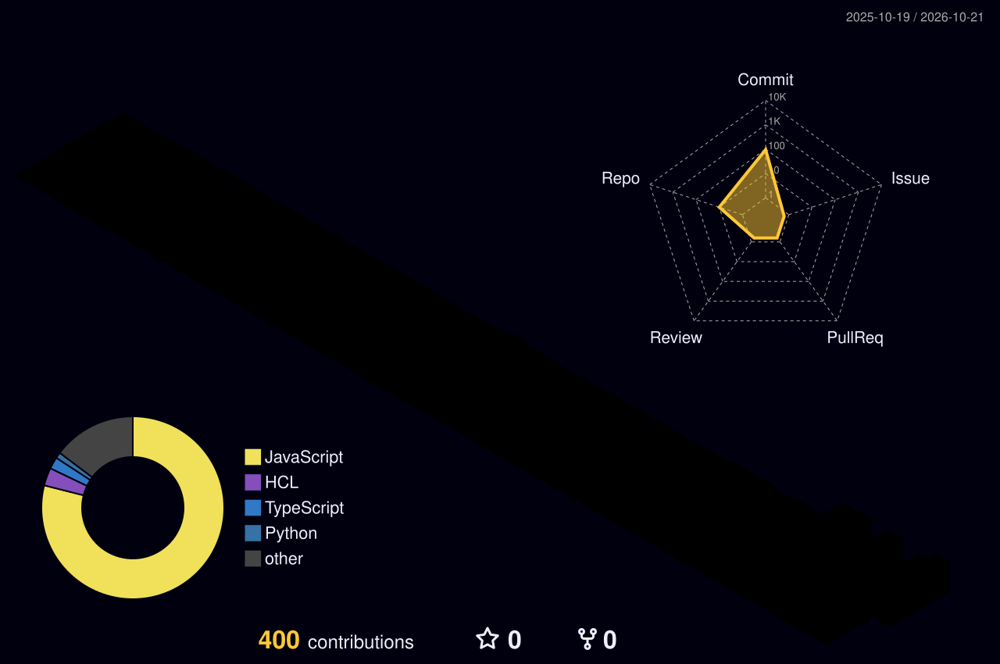

<div align="center">

<!-- Animated gradient header -->


<a href="https://www.linkedin.com/in/ayushgupta344/"></a>
<a href="https://github.com/ayushgupta344"></a>


<br/>


</div>

---

## 🧑‍🚀 About Me

I'm a B.Tech Information Technology student at **KIET Group of Institutions** who enjoys building practical, full-stack products—from e-commerce and learning platforms to real-time applications. I also explore AWS cloud architecture and keep sharpening my problem-solving skills through DSA.


- 🔭 Building production-style full-stack applications
- ☁️ AWS-certified across Cloud Practitioner, AI Practitioner, and Developer – Associate
- 🧠 Practicing DSA and learning system design
- 🌱 Exploring TypeScript, Next.js, and scalable application design
- 🎯 Target: SDE internship opportunities in 2027

<br clear="right"/>

<div align="center">

### 🧊 My Developer Snapshot

<table>
<tr>
<td align="center" width="33%">


**Problem Solving**

</td>
<td align="center" width="33%">


**Cloud Skills**

</td>
<td align="center" width="33%">


**Web Development**

</td>
</tr>
</table>

</div>

<details>
<summary><b>⌘ A little JSON about me</b></summary>

```typescript
const ayush = {
  role: "Full-Stack Developer",
  education: "B.Tech IT @ KIET, 2028",
  stack: ["MongoDB", "Express", "React", "Node.js"],
  exploring: ["TypeScript", "Next.js", "System Design", "AWS"],
  certifications: 3,
  leetcode: "200+ problems solved",
  motto: "Build. Learn. Improve. Repeat."
};
```

</details>

---

## 🚀 Featured Projects

<table>
<tr>
<td width="50%" valign="top">

### 🛍️ [ShopNest](https://github.com/ayushgupta344/MERN-E-COMMERCE)

A full-stack MERN e-commerce platform with payment flow and inventory management.

 

- 💳 Razorpay Payment Links flow
- 📧 OTP email verification via Brevo HTTP API

**[Live Demo ↗](https://shopnest-0alw.onrender.com)**

</td>
<td width="50%" valign="top">

### 🎓 [MERN LMS](https://github.com/ayushgupta344/LMS-MERN)

A learning management platform with educator/student workflows and role-based access.

  

- 🔐 Clerk authentication and webhook sync
- 💰 Stripe-powered course payments

**[Live Demo ↗](https://lms-backend-a3zz.vercel.app)**

</td>
</tr>
<tr>
<td width="50%" valign="top">

### 💬 [Real-Time Chat App](https://github.com/ayushgupta344/MERN-ChatApp)

A real-time messaging application focused on responsive conversations.

 

- ⚡ Live messaging with Socket.IO
- 🐳 Dockerized and deployed on Render

**[Live Demo ↗](https://imessage-9j0m.onrender.com)**

</td>
<td width="50%" valign="top">

### ☁️ AWS & Cloud

Hands-on learning across AWS cloud foundations, AI, and application development.


- ✅ AWS Certified Cloud Practitioner
- ✅ AWS Certified AI Practitioner
- ✅ AWS Certified Developer – Associate

</td>
</tr>
</table>

---

## 🧰 Tech Arsenal

<div align="center">

### Languages & Core


### Frontend & Backend


### Database, Cloud & Tools


</div>

---

## 📈 GitHub Universe

<div align="center">


<br/>

<a href="https://github.com/ayushgupta344?tab=repositories"></a>

</div>

---

## 🌌 3D Contribution View

<div align="center">



</div>

The image below is a local fallback preview, so it will not show as a broken image while the real calendar is being generated. To replace it with your personal 3D contribution history, open the [profile workflow](.github/workflows/profile-3d.yml), go to **Actions**, select **GitHub Profile 3D Contributions**, and click **Run workflow**. Future updates are scheduled daily.

---

## 🎯 Currently Leveling Up

<div align="center">


</div>

- **DSA:** strengthening patterns for coding interviews
- **Full stack:** TypeScript, Next.js, backend architecture
- **Cloud:** AWS architecture and deployment best practices

---

<div align="center">

### 🤝 Let's Connect

<a href="https://www.linkedin.com/in/ayushgupta344/"></a>
<a href="https://github.com/ayushgupta344"></a>

<br/><br/>

<sub><b>B.Tech Information Technology</b> · KIET Group of Institutions · Class of 2028 · CGPA 8.29</sub>


<sub>✨ Thanks for visiting my corner of GitHub. Let's build something impactful.</sub>

</div>
